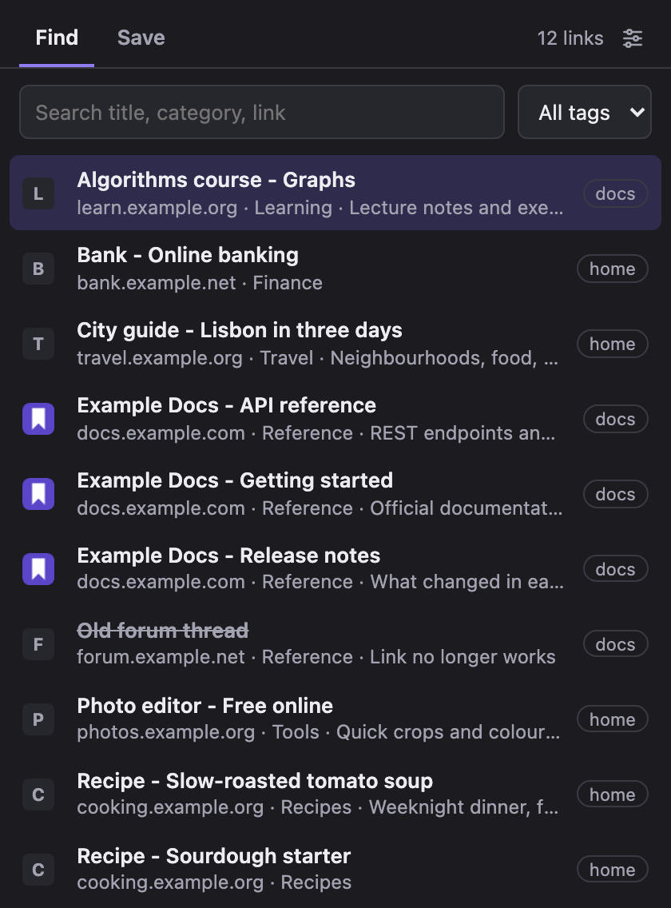
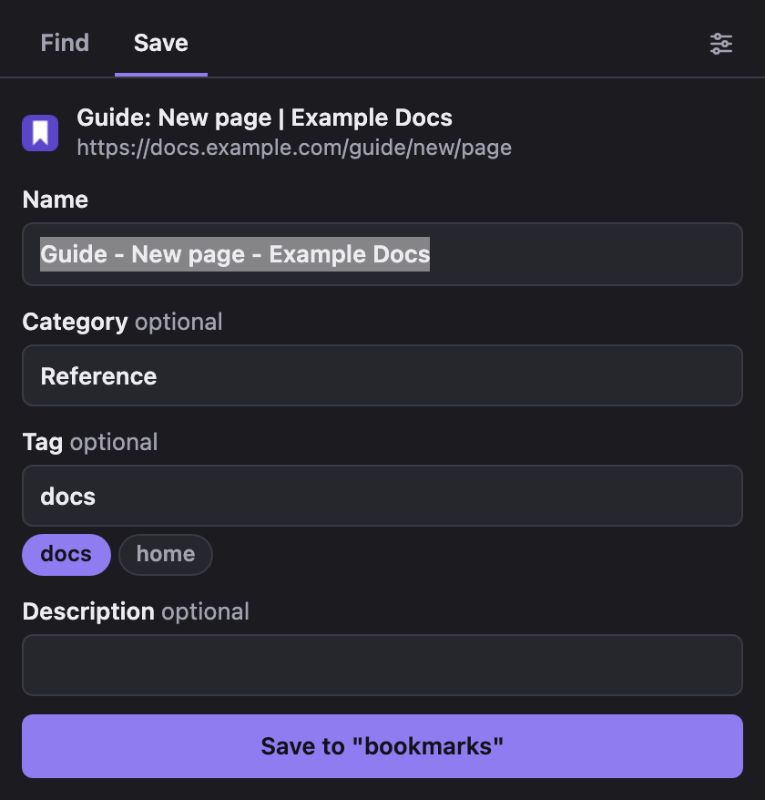

# Vault Bookmarks

Keep your bookmarks as plain Markdown files you own, and search or add them from the Chrome toolbar. The extension reads and writes a folder of notes, one note per link, straight from disk.

It was built for an [Obsidian](https://obsidian.md) vault (the notes are ordinary files with YAML properties, so Obsidian shows them as a table or a list), but it needs nothing from Obsidian: no plugin, no API key, no server, no account. Any folder of Markdown files works, and an empty folder is a fine start. The extension's own code makes no network request; site icons come from Chrome's favicon service. This project is not affiliated with Obsidian.

 

Screenshots use the synthetic notes in `test/fixtures/`.

## Install

The extension is not on the Chrome Web Store: you load it from a copy of this repository.

1. Get the code: `git clone https://github.com/ML9373/vault-bookmarks.git`, or download the ZIP from GitHub and unzip it.
2. Open `chrome://extensions`, turn on **Developer mode**, click **Load unpacked**, and pick the `vault-bookmarks` folder you just got.
3. Click the toolbar icon, then **Open setup**, then **Choose folder** and pick the folder that holds your bookmark notes (or an empty one to start). Pick that folder itself, not a whole vault above it: the setup refuses a folder that contains `.obsidian`.
4. Still on the setup page, check **Note format**. The defaults below suit a folder started from scratch; change the property names if your notes already use others.

## Use

- **Find** (`Cmd+Shift+K` on macOS, `Ctrl+Shift+K` elsewhere, rebindable at `chrome://extensions/shortcuts`): type words from the title, category, description, tag or link. Arrows move, Enter opens, Cmd or Ctrl+Enter opens in the background. The tag filter appears as soon as the notes carry tags. Each link shows the site's icon.
- **Recent, Favorites, All**: three views above the results, combined with the tag filter. **Recent** lists the last links you opened from the popup, newest first. **Favorites** lists the links you starred: the star next to a link sets a checkbox property in its note (`Favorite: true` by default), so Obsidian sees it too. **All** shows one collapsed section per category with its link count: click a section or press Enter to open it, Right and Left arrows open and close it. Typing a search replaces the sections with ranked results. The popup remembers the last view.
- **Edit and delete**: each row has a pencil and a cross (Ctrl or Cmd+E edits the highlighted row). The edit form changes the title, link, category, tags, description and status (`Active`, `Dead`); only the properties you change are rewritten, and the file keeps its name, so wikilinks to it keep working. The cross deletes the note **for good** (there is no trash): the first click turns it into "Delete for good?", the second one deletes. Both re-read the note first and refuse when its link changed on disk since the popup opened.
- **Top** lists the links you open most, with a count. **N duplicates** (shown only when there are some) groups notes that hold the same link, so you can delete the extra ones.
- **Save**: the current tab is pre-filled (an unread counter like `(12)` in front of the title is dropped). Category and tag are suggested from the notes already saved for the same site, and both lists are whatever the notes already use. A link that is already saved is reported instead of duplicated, whatever campaign parameters (`utm_*`, `fbclid`, `gclid`...) it arrives with: the saved link itself keeps its query. The description is pre-filled from the page's own meta description. Tags are several: type one and press Enter or comma, or click a frequent one. When the window holds two or more unsaved http(s) tabs, **Save all N open tabs** writes one note per tab (click twice), each with the category and tag its site already uses.
- **Context menu**: right-click a link or a page, then **Save link to vault** or **Save page to vault**. The toolbar icon shows a check mark (saved), `=` (already saved) or `!` (a problem, usually the folder access that must be allowed again from the popup).
- **Tools** (the wrench at the top right): **Check links** asks each site whether the page still exists and proposes the broken ones as `Dead` (and the Dead ones that answer again as `Active`), nothing changes until you tick and confirm; **Import Chrome bookmarks** writes one note per bookmark, folder as category, skipping links already saved.

The settings button at the top right of the popup opens the setup page at any time: it shows the current folder (its name, how many notes were read, a few titles to recognise it: Chrome never shares the path), and lets you change the folder, the note format, or allow access again. The Save button also names the folder it writes to.

## Note format

With the default settings a new note looks like this:

```yaml
---
title: "Name"
tags:
  - Bookmark
  - work          # the tag picked in the popup, if any
type: bookmark
URL: "https://..."
Category: "Reference"
Description: ""
BookmarkStatus: "Active"
CreationDate: "YYYY-MM-DD"
aliases:
  - "Name"
---
```

A starred link gets one more line, `Favorite: true`, just above the closing `---`; unstarring removes it.

Everything else is configurable on the setup page: the property that marks a note as a bookmark (and its value, or a tag instead), the tag written on every note, the names of the link, category, description, status, creation-date and favorite properties (a blank name turns that field off), and a text written under the properties of every new note (a breadcrumb link to your hub, for example). A note whose status is `Dead` is greyed out in the results.

Tags are free: the extension lists the tags it finds in the notes and lets you type a new one. There is no built-in list of categories or tags.

## What it reads

The `.md` files of the chosen folder, and only their frontmatter (the first 4 KB, more only when the frontmatter is longer). Subfolders are read only if you turn on **Also read the notes in subfolders** in the setup (dot folders never; a note with no category then takes its top-level subfolder's name). A note that is not marked as a bookmark or has no http(s) link is ignored, and no note body is ever parsed or kept. What was read from each note (size and modification date, parsed properties) is cached in the extension's browser storage, so a note that did not change is not read again. The list of recently opened links (link and time, the last 50) and the open counts stay in the extension's own browser storage, never in the notes. Permissions: `activeTab` and `scripting` (read the page description of the tab you opened the popup on, with one small function run on demand, no content script), `tabs` (the address and title of the window's tabs, for **Save all open tabs**), `contextMenus`, and `favicon` (site icons, served by Chrome's own favicon service). Two more are **optional** and asked only when you start the feature: access to websites (Check links) and `bookmarks` (Import). The extension loads no remote code.

## Security notes

- The folder permission covers the folder and everything under it. The setup refuses a folder that contains `.obsidian`, but that is a guard against a wrong click, not a security boundary: the boundary is the folder you pick. Pick the narrowest one.
- The extension can delete a note, only on a double click on the cross or the Delete button of the edit form, and for good. It creates new files and refuses a name that exists. Every change to an existing note (star, edit, status) re-reads the note from disk, checks that it still holds the same link, rewrites only the properties concerned and writes every other byte back unchanged.
- Check links sends a request to every linked site from your machine (that is what it is for); import and the other features send nothing.
- Values written to a note (title, link, category, tag, description) are JSON-quoted or sanitised, and the text under the properties is the one you configured, so a page title cannot inject a code block into a note.
- Loaded unpacked, the extension is the files in this folder: whoever can edit them can use the folder permission. Keep the folder where only you can write.

## Limits

- Version 0.3.0, used so far in Chrome on macOS only: Windows and Linux are untried. Chrome 122+ on desktop. Other Chromium browsers (Edge, Brave) have the File System Access API but have not been tried, and Firefox, Safari and mobile browsers do not have it.
- Chrome may ask to allow the folder again after a restart: the popup then offers **Allow access**.
- A site Chrome has never loaded shows a globe or a letter instead of its icon.
- The popup lists every note each time it opens and reads again only the notes whose size or date changed. Timings below are from 0.2.0, before that cache, on synthetic notes of about 2 KB in a browser-private folder, not on a real disk: 266 notes in 31 ms, 3,000 in 0.4 s, 10,000 in 1.5 s.
- The context menu cannot ask for the folder access again by itself (Chrome allows that only from a page): when it shows `!`, open the popup.
- Check links can flag a live link as dead (a site that blocks automated requests, a temporary outage): that is why it only proposes, and why a timeout, a login wall or a rate limit is never flagged.
- Changing a property name in the settings does not rewrite existing notes: notes under the old name stop showing up.

## Tests

```
node --test "test/*.test.mjs"
```

Node 22 or later (the version the CI uses), no dependency to install. The unit tests cover the frontmatter reader, the settings, the note writer, the favorite flag (added and removed without touching any other byte), the edit and delete of a note against an in-memory folder (`test/features.test.mjs`), the tag merge, duplicates, open counts, the cache, subfolders, saving a link, the Chrome bookmark import and the link check, the recent list and the category grouping, the naming rules (including names Windows refuses) and the search. An optional check against a real folder of notes is described at the top of `test/unit.test.mjs`.

To try the popup without loading the extension, serve the repository root and open the test page:

```
python3 -m http.server
# then open http://localhost:8000/test/harness.html
```

It runs the real popup against a browser-private folder seeded from `test/fixtures/` (synthetic notes), with the `chrome.*` calls replaced by stubs. Parameters: `?settings=<json>` sets the note format, `?view=save` opens the Save tab, `?title=` and `?url=` set the current tab, `?nohandle` starts with no folder chosen. The harness also stubs the window's tabs and the page description.

## License

MIT
